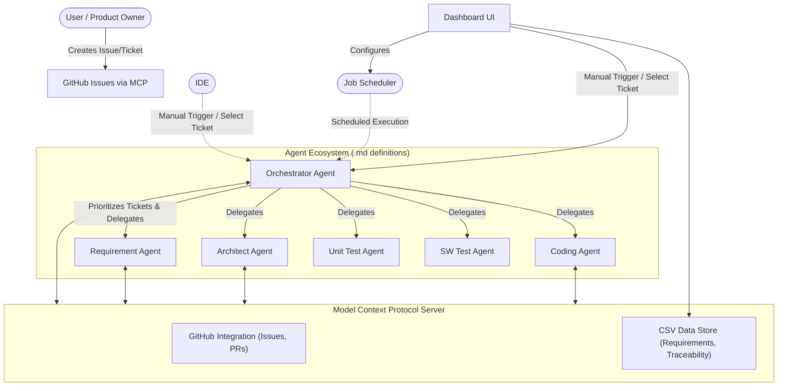

# SWDevFactory
A multi-agent orchestrator framework that automates the software development lifecycle from issue tickets—handling requirements, architecture, coding, unit testing, and SW testing with built-in MCP integration, CSV-based traceability, and a dashboard interface.

## Overview
The Multi-Agent Software Factory is an autonomous, agent-driven software development system built on the Orchestrator-Worker pattern. It is designed to autonomously drive software development directly from issue tickets, ensuring rigorous bidirectional traceability across all work products (Requirements ↔ Architecture ↔ Code ↔ Tests).

## Architecture



## Agent Roles
Our ecosystem consists of specialized agents defined in agnostic Markdown format (`.md`), making them interoperable and compatible with Antigravity, Codex, or standard setups.

1. **Orchestrator Agent**: Ingests issue tickets, parses context, builds the execution plan, delegates subtasks to workers, and aggregates results.
2. **Requirement Agent**: Translates raw tickets into formal, testable requirements. breakdown the requirements into testable units. Interacts with the user to clarify ambiguities and explicitly shares assumptions for approval.
3. **Architect Agent**: Defines interfaces, system boundaries, and static/dynamic analysis expectations. Ensures requirement traceability, enforces simple design choices as a priority, and guides the Coding Agent.
4. **Coding Agent**: Implements the codebase based on the Architect's blueprints and the Requirement Agent's specifications.
5. **Unit Test Agent**: Automatically generates and implements unit tests based on the available code and structural boundaries.
6. **SW Test Agent**: Develops high-level, black-box software test cases mapped directly back to the formalized requirements.

## Core Features
- **MCP Integration**: Relies on standardized remote Model Context Protocol (MCP) servers—like the official `@modelcontextprotocol/server-github`—to interact natively with GitHub (reading issues, writing PRs, committing architecture docs), avoiding the need to build custom integrations.
- **Configurable Workspace**: All subagents maintain their work products (Requirements, Architecture, Code, Tests) in a dedicated, configurable `workspace/` folder defined by `config/ProjConfig/settings.json`.
- **CSV Data Store**: All requirements and traceability matrices are strictly documented, versioned, and stored in structured CSV formats within the workspace.
- **Traceability Engine**: Enforces strict bidirectional traceability linking Requirements ↔ Architecture ↔ Code ↔ Tests. 
- **Execution Logging & Fallbacks**: The Orchestrator strictly logs all operations, failures, and fallbacks into structured execution logs to prevent silent failures and provide transparent summaries.
- **Token & Cost Analytics**: The Orchestrator seamlessly tracks LLM token consumption (prompt/completion) and estimated costs across all subagent activities. Cost metrics are explicitly logged to GitHub as ticket remarks upon activity completion, and dynamically visualized per-subagent inside the Dashboard.
- **Dashboard Interface**: A visual UI to monitor agent execution states, configure scheduling for the Orchestrator, manually trigger ticket processing, track the end-to-end traceability matrix, visualize token consumption costs, and analyze execution logs (including errors and warning fallbacks).

## Workflow
1. **Trigger & Prioritization**: The system can be started via a scheduled job configured in the Dashboard, or triggered manually from the IDE or Dashboard (where a specific ticket can also be selected). When running autonomously, the Orchestrator checks open GitHub Issues via MCP and decides on implementation priority.
2. **Requirements**: Requirement Agent processes the issue into formal CSV requirements, seeking user clarifications if needed.
3. **Design**: Architect Agent generates system blueprints and interface definitions.
4. **Implementation**: Coding Agent writes the source code based on designs.
5. **Testing**: Unit Test Agent writes code-level tests; SW Test Agent creates black-box test cases traceable to the CSV requirements.
6. **Delivery**: Orchestrator aggregates the results, verifies traceability, and creates a PR via GitHub MCP.

## How to Use

The repository is equipped with native 1-click execution scripts for both macOS/Linux and Windows environments. These scripts will automatically manage the Python virtual environment and dependencies for you.

### macOS & Linux
1. **First-Time Setup**: Open your terminal in the project directory and run the setup script to install dependencies.
   ```bash
   ./setup.sh
   ```
2. **Launch Dashboard**: Start the system UI control plane.
   ```bash
   ./run.sh
   ```

### Windows
1. **First-Time Setup**: Double-click `setup.bat` from your File Explorer to create the virtual environment and install dependencies.
2. **Launch Dashboard**: Double-click `run.bat` to boot up the system UI control plane.

### Inside the Dashboard
Once the dashboard opens in your browser:
* **Job Control**: Navigate to the `Job Control` tab to manually trigger the Orchestrator by entering a GitHub Ticket ID, or configure an automated schedule.
* **Traceability Matrix**: View the live, mathematical proof linking requirements to code and tests.
* **Token Analytics**: Monitor the cost and token consumption of each agent's activity.
* **System Logs**: View raw outputs, self-healing repairs, and GitHub API fallbacks.
