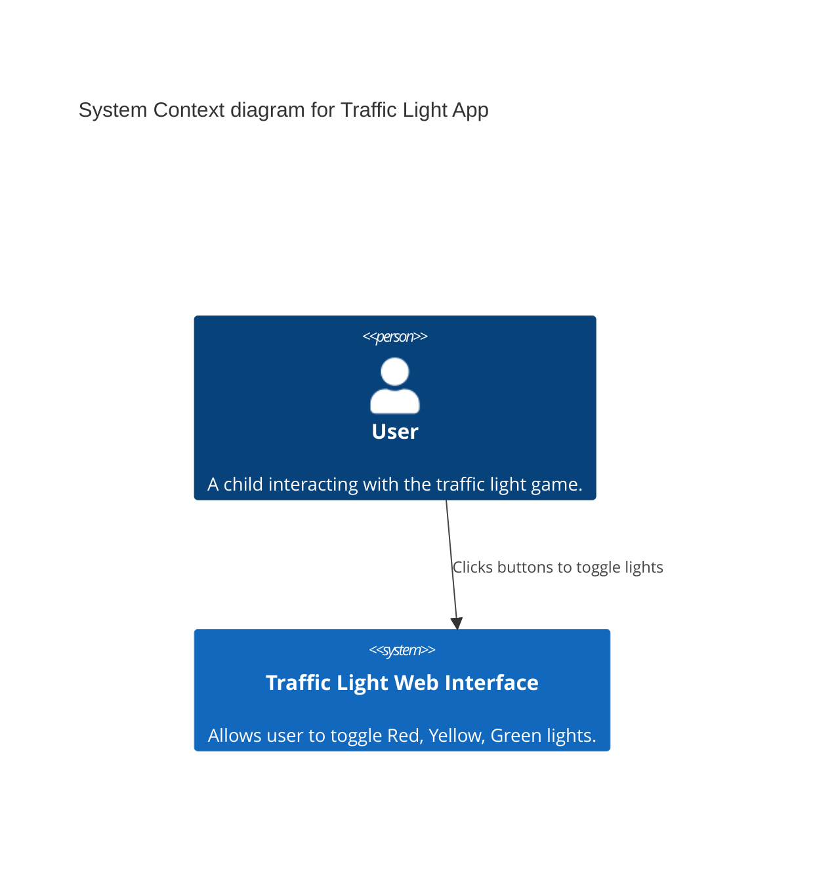
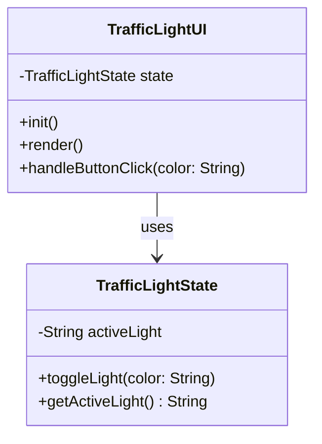
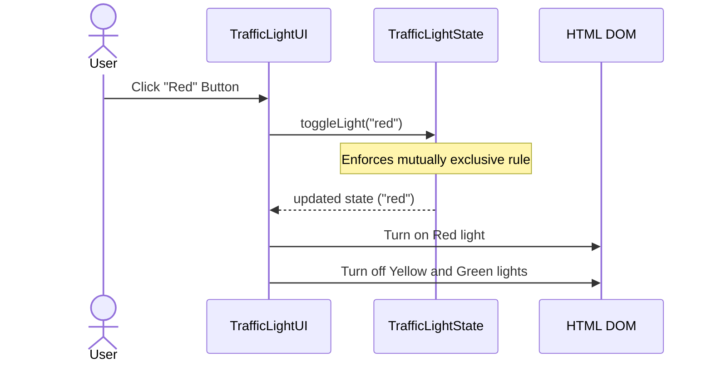

# Traffic Light Web Interface Architecture

This document outlines the architectural design for the Traffic Light Web Interface, satisfying requirements REQ-1-01 and REQ-1-02.

## System Overview

The system is a simple, interactive web-based demonstration game consisting of a vertical traffic light (Red, Yellow, Green) and corresponding control buttons. 

## Design Principles Adherence

- **Separation of Concerns (SoC):** The architecture cleanly separates the structural presentation (HTML), visual styling (CSS), and interactive logic (JavaScript). 
- **Single Responsibility Principle (SRP):** The JavaScript logic is divided into two main components:
  - `TrafficLightState`: Solely responsible for maintaining the state of the lights and enforcing the business rule that only one light can be active at a time.
  - `TrafficLightController`: Solely responsible for wiring DOM events to the state and updating the UI when the state changes.
- **Keep It Simple, Stupid (KISS):** We are using Vanilla HTML, CSS, and JS. No complex frameworks are introduced, as the scope of the requirement does not demand it.
- **Loose Coupling:** The `TrafficLightState` class is entirely decoupled from the DOM. It can be tested in isolation without needing a browser environment.
- **Don't Repeat Yourself (DRY):** Button click handlers and light toggling logic will be generalized to avoid repetitive code for each color.

## C4 Context Diagram



## Class Diagram



## Sequence Diagram (Toggle Interaction)



## Directory Structure Scaffold

The code will be structured as follows in `workspace/Code/`:

```
workspace/Code/
├── index.html   (Structure & layout)
├── styles.css   (Styling for traffic light and buttons)
└── app.js       (TrafficLightState and TrafficLightUI logic)
```