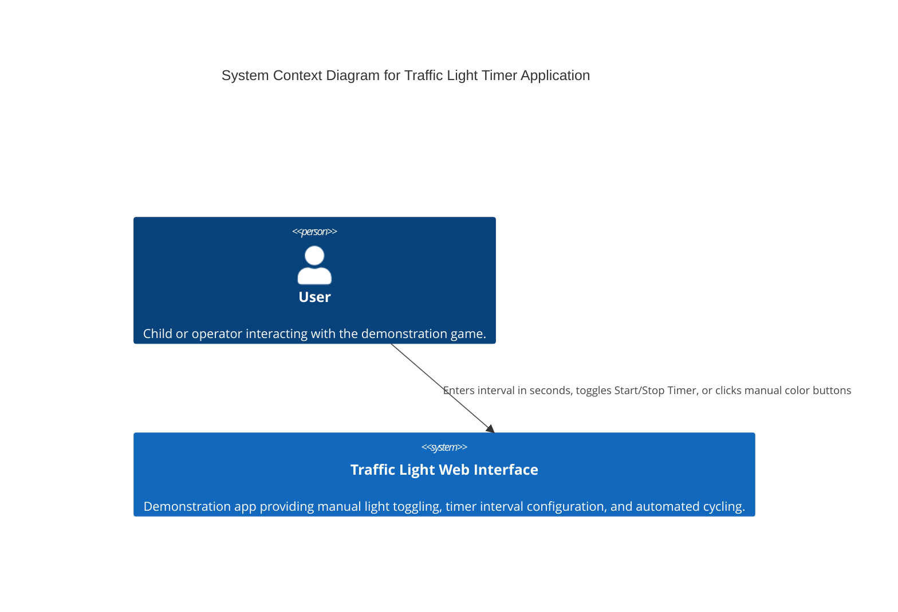
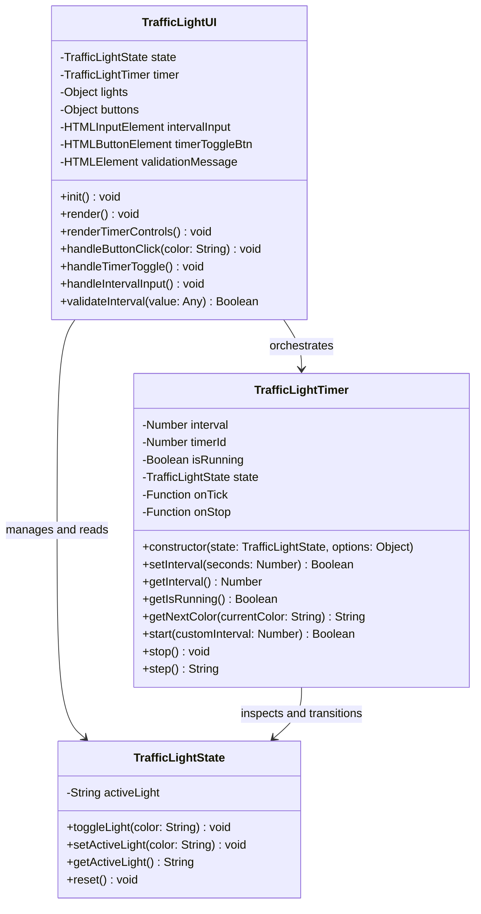
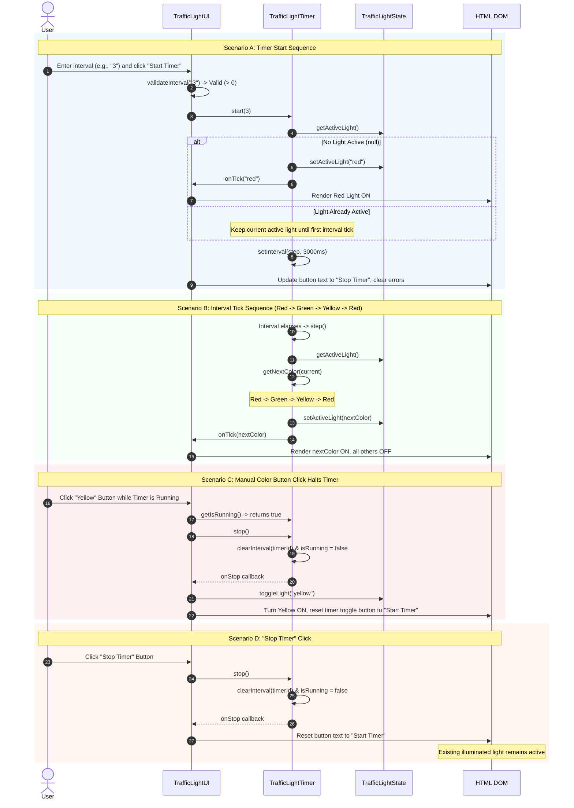
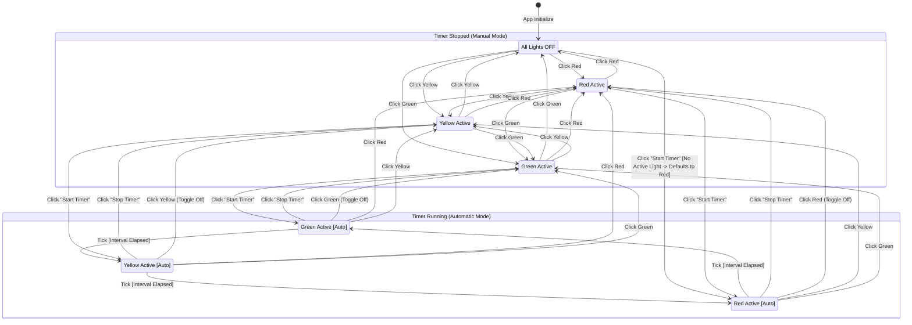

# Traffic Light Timer Architecture Specification

**Ticket:** GitHub Issue #2  
**Requirements Addressed:** `REQ-2-01`, `REQ-2-02`  
**Parent Document:** [`traffic_light_architecture.md`](file:///Users/user/AIDev/AntiGravity_Projects/SWDevFactory/workspace/Architecture/traffic_light_architecture.md)  
**Author:** Architect Agent  
**Status:** Approved  

---

## 1. System Overview

This architecture document extends the Traffic Light Demonstration application to incorporate automated timing controls and cycle sequencing as specified in GitHub Issue #2. The extension introduces two core functional capabilities:

1. **Configurable Timer Controls (`REQ-2-01`):** Users can define an automated switching interval in seconds via a validated numeric input field (defaulting to 3 seconds) and control cycling via a toggle button ("Start Timer" / "Stop Timer"). Non-positive or invalid inputs are prevented or ignored with visual feedback.
2. **Automatic Cycle Sequencing & Manual Interruption (`REQ-2-02`):** While running, the traffic light automatically transitions sequentially through colors in the fixed order: `Red -> Green -> Yellow -> Red` at the configured interval. If started with no light active, the cycle immediately begins by illuminating Red. Mutual exclusion (at most one light active at any time) is strictly preserved. Any manual color button click or clicking "Stop Timer" immediately halts the automatic timer.

---

## 2. Architectural Principles Adherence

The architecture strictly adheres to the core guidelines defined in [`prompts/design_pattern_guidelines.md`](file:///Users/user/AIDev/AntiGravity_Projects/SWDevFactory/prompts/design_pattern_guidelines.md):

| Principle | Architectural Decision & Implementation Boundary |
| :--- | :--- |
| **Separation of Concerns (SoC)** | • **Presentation Layer:** HTML structure ([`index.html`](file:///Users/user/AIDev/AntiGravity_Projects/SWDevFactory/workspace/Code/index.html)) and CSS styling ([`styles.css`](file:///Users/user/AIDev/AntiGravity_Projects/SWDevFactory/workspace/Code/styles.css)).<br>• **Domain State:** [`TrafficLightState`](file:///Users/user/AIDev/AntiGravity_Projects/SWDevFactory/workspace/Code/app.js) encapsulates color states and mutual exclusion.<br>• **Domain Timing:** [`TrafficLightTimer`](file:///Users/user/AIDev/AntiGravity_Projects/SWDevFactory/workspace/Code/app.js) encapsulates sequence progression and scheduling.<br>• **View Controller:** [`TrafficLightUI`](file:///Users/user/AIDev/AntiGravity_Projects/SWDevFactory/workspace/Code/app.js) handles DOM rendering, inputs, event bindings, and validation feedback. |
| **Single Responsibility Principle (SRP)** | • `TrafficLightState` has one reason to change: modifications to valid light colors or mutual exclusion rules.<br>• `TrafficLightTimer` has one reason to change: modifications to timing scheduling, step sequencing (`Red -> Green -> Yellow -> Red`), or timer lifecycle controls.<br>• `TrafficLightUI` has one reason to change: adjustments to user interface controls, DOM layout, or user input presentation. |
| **Loose Coupling** | • `TrafficLightTimer` and `TrafficLightState` have **zero dependencies on the DOM** (`window`, `document`, or HTML elements).<br>• `TrafficLightTimer` communicates state transitions via dependency injection of `TrafficLightState` and generic callbacks (`onTick`, `onStop`).<br>• All business and timer logic can be executed and unit-tested in isolation in headless Node.js environments using mock timers. |
| **High Cohesion** | • All interval arithmetic, scheduling handlers (`setInterval`/`clearInterval`), and cycle transition formulas are contained exclusively within `TrafficLightTimer`.<br>• All DOM queries and UI element attribute updates are contained within `TrafficLightUI`. |
| **Don't Repeat Yourself (DRY)** | • Cycle ordering (`Red -> Green -> Yellow -> Red`) is centralized in a single transition lookup method `TrafficLightTimer.getNextColor()`.<br>• Light rendering logic is unified: whether triggered by user click or timer tick, DOM updates funnel through `TrafficLightUI.render()`.<br>• Halting logic is centralized: manual button clicks and "Stop Timer" both invoke `TrafficLightTimer.stop()`. |
| **Keep It Simple, Stupid (KISS)** | • Implemented in clean, modern Vanilla JavaScript (ES6+ classes).<br>• Avoids heavyweight external libraries, state-machine frameworks, or reactive runtime overhead.<br>• Uses native `setInterval` / `clearInterval` abstractions with explicit guards. |
| **Design for Change** | • Timer interval defaults, transition cycles, and step callbacks are parameterized, allowing future extension (e.g., configurable sequence orders, custom phase durations per color, or sound effects) without rewriting core logic. |

---

## 3. Requirements Traceability Matrix

| Requirement ID | Summary | Architectural Component | Interface / Responsibility |
| :--- | :--- | :--- | :--- |
| **`REQ-2-01`** | Numeric interval text box (default 3s, positive numbers only) | `TrafficLightUI`<br>`TrafficLightTimer` | `TrafficLightUI.validateInterval()` enforces positive integer/float.<br>`TrafficLightTimer.setInterval()` holds and verifies active interval. |
| **`REQ-2-01`** | Start/Stop toggle button | `TrafficLightUI`<br>`TrafficLightTimer` | `TrafficLightUI.handleTimerToggle()` dynamically switches button text & styles.<br>`TrafficLightTimer.start()` / `stop()` manages running state. |
| **`REQ-2-02`** | Automatic cycling: Red -> Green -> Yellow -> Red | `TrafficLightTimer` | `TrafficLightTimer.step()` and `TrafficLightTimer.getNextColor()` evaluate the strict sequential order. |
| **`REQ-2-02`** | Initial illumination of Red if no light is active | `TrafficLightTimer`<br>`TrafficLightState` | `TrafficLightTimer.start()` verifies active light; if `null`, initializes state to `'red'` immediately upon cycle start. |
| **`REQ-2-02`** | Mutual exclusion during cycling | `TrafficLightState` | `TrafficLightState.setActiveLight()` guarantees only one active color at all times. |
| **`REQ-2-02`** | Manual button click or Stop Timer immediately halts cycle | `TrafficLightUI`<br>`TrafficLightTimer` | `TrafficLightUI.handleButtonClick()` checks `timer.getIsRunning()`, calls `timer.stop()`, then applies manual toggle. |

---

## 4. Mermaid System Diagrams

### 4.1 C4 Context Diagram



### 4.2 Class Diagram



### 4.3 Sequence Diagram: Timer Lifecycle & Interactions



### 4.4 State Transition Diagram



---

## 5. Component Specifications & Interfaces

### 5.1 `TrafficLightState`

Maintains the core business rules for light states.

#### Methods:
*   `getActiveLight(): string | null`
    *   **Returns:** `'red'`, `'yellow'`, `'green'`, or `null`.
*   `setActiveLight(color: string | null): void`
    *   **Parameters:** `color` - One of `'red'`, `'yellow'`, `'green'`, or `null`.
    *   **Pre-conditions:** `color` must be a valid color string or `null`.
    *   **Post-conditions:** `this.activeLight` set to specified color.
*   `toggleLight(color: string): void`
    *   **Parameters:** `color` - Color to toggle.
    *   **Behavior:** If `this.activeLight === color`, sets to `null`; otherwise sets to `color`.
*   `reset(): void`
    *   **Behavior:** Resets `this.activeLight` to `null`.

---

### 5.2 `TrafficLightTimer`

Autonomous scheduling controller decoupled from any DOM dependencies.

#### Properties:
*   `state: TrafficLightState` - Injected instance of `TrafficLightState`.
*   `interval: number` - Active interval duration in seconds (default: `3`).
*   `timerId: number | null` - Browser/Node interval timer reference.
*   `isRunning: boolean` - Operational status flag.
*   `onTick: ((color: string) => void) | null` - Optional callback invoked on state transition.
*   `onStop: (() => void) | null` - Optional callback invoked when the timer halts.

#### Method Contracts:

##### `constructor(state, options = {})`
*   **Signature:** `constructor(state: TrafficLightState, options?: { interval?: number, onTick?: Function, onStop?: Function })`
*   **Behavior:** Stores `state`, initializes `interval` (defaulting to 3), sets `isRunning = false` and `timerId = null`.

##### `setInterval(seconds)`
*   **Signature:** `setInterval(seconds: number): boolean`
*   **Parameters:** `seconds` - Interval value in seconds.
*   **Validation:** Must be a finite number greater than 0 (`Number(seconds) > 0 && Number.isFinite(Number(seconds))`).
*   **Returns:** `true` if valid and updated; `false` otherwise.
*   **Side-effects:** If the timer is actively running, restarts the active `setInterval` with the updated interval immediately.

##### `getInterval()`
*   **Signature:** `getInterval(): number`
*   **Returns:** Current configured interval in seconds.

##### `getIsRunning()`
*   **Signature:** `getIsRunning(): boolean`
*   **Returns:** `true` if automatic timer is running, `false` otherwise.

##### `getNextColor(currentColor)`
*   **Signature:** `getNextColor(currentColor: string | null): string`
*   **Parameters:** `currentColor` - Current illuminated color or `null`.
*   **Return Mapping:**
    *   `null` $\rightarrow$ `'red'`
    *   `'red'` $\rightarrow$ `'green'`
    *   `'green'` $\rightarrow$ `'yellow'`
    *   `'yellow'` $\rightarrow$ `'red'`
*   **Purity:** Pure deterministic mapping function.

##### `step()`
*   **Signature:** `step(): string`
*   **Behavior:**
    1. Reads `current = this.state.getActiveLight()`.
    2. Determines `nextColor = this.getNextColor(current)`.
    3. Executes `this.state.setActiveLight(nextColor)`.
    4. If `this.onTick` is defined, invokes `this.onTick(nextColor)`.
*   **Returns:** `nextColor`.

##### `start(customInterval?: number)`
*   **Signature:** `start(customInterval?: number): boolean`
*   **Pre-conditions:** Timer is not already running.
*   **Behavior:**
    1. If `customInterval` is provided, validates and sets it. If invalid, returns `false`.
    2. If `this.state.getActiveLight() === null`, sets active light to `'red'` immediately and triggers `onTick('red')` (`REQ-2-02`).
    3. Sets `this.isRunning = true`.
    4. Clears any existing `this.timerId`.
    5. Establishes periodic interval: `this.timerId = setInterval(() => this.step(), this.interval * 1000)`.
*   **Returns:** `true` if started successfully; `false` if interval invalid.

##### `stop()`
*   **Signature:** `stop(): void`
*   **Behavior:**
    1. If `this.timerId` is set, calls `clearInterval(this.timerId)` and sets `this.timerId = null`.
    2. Sets `this.isRunning = false`.
    3. If `this.onStop` is defined, invokes `this.onStop()`.
*   **Post-conditions:** Timer interval loop is halted. Current active light state remains unchanged in `this.state`.

---

### 5.3 `TrafficLightUI`

Presentation coordinator binding the DOM and orchestrating interactions between `TrafficLightState` and `TrafficLightTimer`.

#### Responsibilities:
1. **DOM Elements Query & Binding:**
   *   Light visual elements: `#red-light`, `#yellow-light`, `#green-light`.
   *   Manual color buttons: `#red-btn`, `#yellow-btn`, `#green-btn`.
   *   Timer interval input: `#timer-interval-input` (numeric input, default `3`).
   *   Timer toggle button: `#timer-toggle-btn` ("Start Timer" / "Stop Timer").
   *   Validation message element: `#timer-error-msg`.
2. **Event Handlers:**
   *   `handleButtonClick(color)`:
       *   If `this.timer.getIsRunning() === true`, invokes `this.timer.stop()`.
       *   Toggles color via `this.state.toggleLight(color)`.
       *   Renders updated lights and timer controls.
   *   `handleTimerToggle()`:
       *   If `this.timer.getIsRunning()`:
           *   Calls `this.timer.stop()`.
           *   Renders timer toggle button as "Start Timer".
       *   If stopped:
           *   Validates interval from `#timer-interval-input`.
           *   If valid: starts timer via `this.timer.start(interval)`, renders button as "Stop Timer", clears error message.
           *   If invalid: renders error message, does not start timer.
   *   `handleIntervalInput()`:
       *   Performs live validation; displays error if `<= 0` or non-numeric.
3. **Render Coordination:**
   *   `render()`: Synchronizes `.active` and color CSS classes on the light circles.
   *   `renderTimerControls()`: Synchronizes button label ("Start Timer" vs "Stop Timer"), active state classes, and error messages.

---

## 6. HTML and CSS Structural Contract

### 6.1 DOM Markup Additions (`workspace/Code/index.html`)

The controls section will be augmented with a semantic timer control panel:

```html
<div class="timer-controls">
    <div class="input-group">
        <label for="timer-interval-input">Interval (seconds):</label>
        <input 
            type="number" 
            id="timer-interval-input" 
            name="timer-interval"
            value="3" 
            min="0.1" 
            step="any" 
            placeholder="3"
        />
        <span id="timer-error-msg" class="error-msg" aria-live="polite"></span>
    </div>
    <button id="timer-toggle-btn" class="btn timer-btn">Start Timer</button>
</div>
```

### 6.2 Styling Rules (`workspace/Code/styles.css`)

*   `.timer-controls`: Flexbox container centered beneath the color buttons with consistent padding, gap, and rounded borders.
*   `.timer-btn`: Accessible button styling with distinct states (`Start Timer` in neutral/primary styling, `Stop Timer` in prominent warning/active styling).
*   `.error-msg`: Accessible inline validation text styled in warning/red font, hidden when input is valid.

---

## 7. Verification and Testing Architecture

1. **Unit Testing Strategy (`workspace/Tests/Unit/`):**
   *   **Mock Timers (`jest.useFakeTimers()`):** `TrafficLightTimer` will be tested without real-time delays, testing edge cases like starting with null state, cycling through multiple iterations (`Red -> Green -> Yellow -> Red -> Green`), dynamically updating interval, and halting on `stop()`.
   *   **Validation Testing:** Boundary tests for invalid intervals (`0`, `-5`, `""`, `"abc"`, `null`, `undefined`) to verify proper error rejection and state preservation.
   *   **Isolation:** `TrafficLightState` and `TrafficLightTimer` are tested in pure Node.js environments without DOM dependencies.
2. **End-to-End Testing Strategy (`workspace/Tests/E2E/`):**
   *   Cypress test suite to verify:
       *   Default 3s interval load and positive validation feedback.
       *   Clicking "Start Timer" initializes Red light when all are off.
       *   Sequential auto-transitioning (`Red -> Green -> Yellow -> Red`).
       *   Clicking a manual button while auto-cycle is running immediately stops the timer and activates the clicked light.
       *   Clicking "Stop Timer" stops the cycle and preserves the currently lit color.
